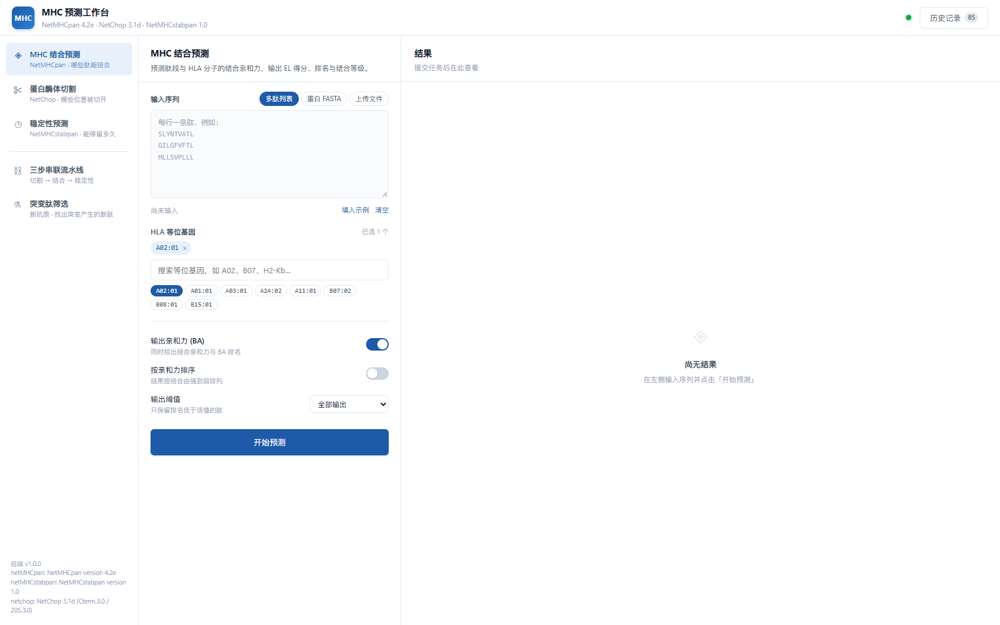
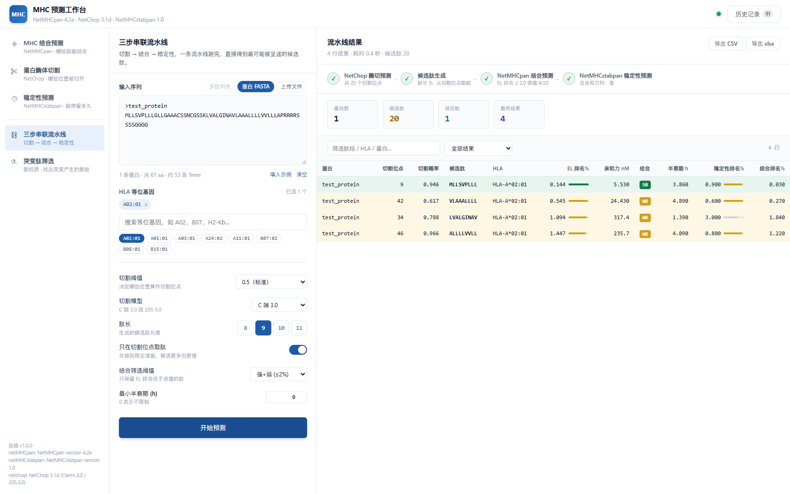

# MHC 预测工作台

> 一键整合 **NetMHCpan 4.2e / NetChop 3.1d / NetMHCstabpan 1.0** 三个免疫学预测工具的 Web 应用。
> 双击启动，浏览器即用，局域网共享 —— 无需命令行。

## 📥 下载（无需登录、无需 git）

| 方式 | 链接 |
|---|---|
| **直接下载 ZIP**（推荐） | https://codeload.github.com/beginner-linlin/MHC/zip/refs/heads/main |
| GitHub 主页 → 绿色 Code → Download ZIP | https://github.com/beginner-linlin/MHC |
| git 克隆 | `git clone https://github.com/beginner-linlin/MHC.git` |

- 仓库为 **public**，任何人可匿名下载/克隆，无需 GitHub 账号。
- 若 `github.com` 主页打不开（网络原因），直接用上面的 **codeload ZIP 链接**下载，或切换网络后重试。
- 下载解压后，按本页[「部署」](#部署)一节安装 DTU 学术工具与 WSL 环境即可运行。



## 功能

| 模式 | 引擎 | 用途 |
|---|---|---|
| **结合预测** | NetMHCpan 4.2e | 肽段-MHC 结合亲和力（EL/BA 得分、%Rank、nM、SB/WB） |
| **酶切预测** | NetChop 3.1d | 蛋白酶体切割位点（C-term 3.0 / 20S 3.0 双模型） |
| **稳定性预测** | NetMHCstabpan 1.0 | pMHC 复合物半衰期 + 综合评分 |
| **流水线** | 三引擎串联 | 酶切 → 候选肽 → 结合 → 稳定性，一次跑完 |
| **突变肽筛选** | NetMHCpan + stabpan | 野生型/突变型比对，只预测覆盖突变位点的肽 |
| **新抗原一键筛选** | UniProt + 三引擎串联 | **只写突变名**（`KRAS G12D`），自动取序列 → 造突变肽 → 三步串联 |
| **资源中心** | GDC / IEDB | TCGA 突变检索、IEDB 云端预测、工具与数据库清单 |
| **智能助手** | OpenAI 兼容模型 | 自然语言驱动上述工具（UniProt/ClinVar/PubMed/GDC 等 9 个工具） |

- 10,491 个 HLA 等位基因全量搜索（HLA-A/B/C/E/G）
- 多肽列表 / 蛋白 FASTA / CSV / Excel 输入，多等位基因批量预测
- 结果表格：搜索、SB/WB 筛选、点列头排序、CSV 与 xlsx 导出
- 任务历史存档（SQLite），可回看可重导出
- 局域网访问：同一网络下其他人浏览器直连，零安装

### 新抗原一键筛选（v1.3.0）

把设计书里的「突变位点 → 候选肽 → 多维打分」压成一条链路：

```
GDC 检索 TCGA-PAAD 真实突变  →  一键导入（自动过滤错义突变）
   ↓
UniProt REST 按基因取规范序列（gene_exact + reviewed:true，本地 JSON 缓存）
   ↓
按 HGVS 氨基酸改变构造突变蛋白
   ↓
NetChop 酶切（切割位点作候选肽 C 端标注）
   ↓
NetMHCpan 突变肽 + 野生型对照（算 Δ排名）
   ↓
NetMHCstabpan 半衰期 + 综合排名
```

实测（TCGA-PAAD 真实 KRAS 突变 × 6 HLA）：8 个突变 → 152 条候选肽 → 6.1 s → 23 行结果，7 SB + 16 WB；
Top1 `KRAS G12V / VVGAVGVGK / HLA-A*11:01 / EL 0.172% / 112.3 nM / SB`。



## 架构

```
浏览器（本机或局域网任意设备）
   │  http://<主机IP>:8080
   ▼
Windows · Node 反向代理（host/server.js，监听 0.0.0.0:8080）
   │  http://127.0.0.1:8008（WSL localhost 转发）
   ▼
WSL Ubuntu · Flask 后端（mhc/，Python 3.12 + Flask 3.1 + SQLite）
   │  subprocess 调用
   ▼
NetMHCpan 4.2e · NetChop 3.1d · NetMHCstabpan 1.0（/opt/bio/）
```

为什么这样设计：三个工具只有 Linux x86_64 二进制，必须跑在 WSL 里；而 WSL NAT 网络无法被局域网直连，所以在 Windows 侧放一个 Node 反向代理打通局域网（借用系统已有的 node.exe 防火墙规则，无需管理员权限）。

## 部署（Windows + WSL）

### 前置条件

- Windows 10/11 + **WSL2（Ubuntu 24.04）**
- Node.js（Windows 侧，默认路径 `C:\AI\node.exe`，可改）
- Python 3.12 + Flask + openpyxl（装在 WSL venv 里，见下方步骤）

### 步骤

1. **下载三个工具**（学术免费，需在 DTU Health Tech 注册）：
   - NetMHCpan 4.2e（`netMHCpan-4.2estatic.Linux.tar.gz`，~116 MB）
   - NetChop 3.1d（`netchop-3.1d.Linux.tar.gz`）
   - NetMHCstabpan 1.0（`netMHCstabpan-1.0cstatic.Linux.tar.gz`）+ 其 `data.tar.gz`
   
   下载地址：`https://services.healthtech.dtu.dk/` 对应产品页面。**工具版权归 DTU/CBS 所有，请自行注册下载；本仓库不含这些二进制。**

2. **安装到 WSL**（在 WSL 内执行）：
   ```bash
   sudo mkdir -p /opt/bio/src && cd /opt/bio/src
   # 把 4 个 tar.gz 复制到这里，然后：
   sudo tar xzf netMHCpan-4.2estatic.Linux.tar.gz -C /opt/bio/
   sudo tar xzf netchop-3.1d.Linux.tar.gz      -C /opt/bio/
   sudo tar xzf netMHCstabpan-1.0cstatic.Linux.tar.gz -C /opt/bio/
   sudo tar xzf data.tar.gz -C /opt/bio/netMHCstabpan-1.0/   # stabpan 的数据包
   sudo apt-get install -y tcsh
   sudo mkdir -p /opt/bio/netMHCpan-4.2/tmp /opt/bio/netchop-3.1/tmp /opt/bio/netMHCstabpan-1.0/tmp
   sudo chmod 1777 /opt/bio/*/tmp
   # 三个 launcher 的 NMHOME 改为各自安装路径（scripts/09_configure.sh 可参考）
   ```

3. **部署本应用**：
   ```bash
   # WSL 内：建 venv 并装依赖
   sudo apt-get install -y python3-venv
   sudo mkdir -p /opt/bio/app && sudo cp -r <本仓库>/mhc-app/. /opt/bio/app/
   python3 -m venv /opt/bio/app/venv
   /opt/bio/app/venv/bin/pip install flask openpyxl
   ```
   项目自带 `scripts/110_deploy_app.sh`、`scripts/09_configure.sh` 等完整部署脚本（在本仓库 `scripts/` 目录，按编号即执行顺序）。

4. **启动**：Windows 侧双击 `启动MHC工作台.bat`（或 PowerShell 运行 `mhc-app\host\launch.ps1`）。

> 三个 .bat 启动器为 **GBK 编码**（中文 Windows cmd 原生），在非中文系统上请用 `mhc-app\host\launch.ps1` 代替。

## 使用

详见 **[docs/MHC工作台使用说明.md](docs/MHC工作台使用说明.md)**（完整手册：模式用法、参数、结果解读、常见问题）。

快速上手：双击启动 → 粘贴一条肽 `SLYNTVATL` → 开始预测 → 应得 EL 排名 0.083 / 亲和力 75.81 nM / **SB（强结合）**。

## 测试

| 套件 | 脚本 | 结果 |
|---|---|---|
| 浏览器端到端（真实 Chrome，13 组 54 断言） | `mhc-app/host/browser_test.js` | 54/54 |
| 资源中心（GDC 检索 / IEDB / 工具清单） | `mhc-app/host/res_test.js` | 35/35 |
| 新抗原模式（UniProt / 预览 / 校验 / 导入） | `mhc-app/host/neo_test.js` | 36/36 |
| 胰腺癌真实场景（GDC→UniProt→三步串联→导出→历史） | `mhc-app/host/paad_e2e.js` | 31/31 |
| 真实场景（FLU/EGFR/KRAS/P53/新冠 RBD 等真实蛋白） | `scripts/130_real_scenarios.sh` | 33/33 |
| 模式感知输入校验 | `scripts/133_validate_mode_aware.sh` | 9/9 |

性能参考：300 aa 蛋白 × 1 等位基因 0.4 s；500 aa 流水线（9,10 肽长 × 2 等位基因）2.0 s；
新抗原 5 突变 × 4 HLA 全链路（含 UniProt 取序列）2.4 s。

## 目录结构

```
├── 启动MHC工作台.bat / 停止MHC工作台.bat / 查看日志.bat   # Windows 双击入口（GBK）
├── mhc-app/
│   ├── serve.py               # Flask 入口
│   ├── mhc/                   # 后端：runner(工具调用/解析) jobs(任务) pipeline(流水线/突变) exporters(导出) web(API)
│   ├── mhc/static/            # 前端：index.html / app.js / style.css
│   └── host/                  # Windows 反向代理 server.js + launch.ps1 + WSL start_backend.sh + E2E 测试
├── scripts/                   # 全套部署/调试/测试脚本（108 个，按编号即历程）
└── docs/                      # 使用说明 / 安装调试报告 / CLI 指南 / 截图
```

## 已知限制

- 三个预测引擎为 Linux 二进制，本应用依赖 WSL（Windows）或原生 Linux（可自行移植 launch 脚本）
- 稳定性模式肽长 <7 或 >20 时亲和力列为空（引擎限制，前端已警告）
- netMHCstabpan 的亲和力列（`-ia`）通过兼容层提供：原版要求 NetMHCpan-2.8（已停止分发），本应用用 4.2 模拟等价输出，稳定性列与官方期望输出逐字节一致
- Flask 开发服务器承载（局域网小团队场景足够，非公网生产级）
- 新抗原模式依赖 UniProt / GDC 公网可达；离线时 UniProt 命中本地缓存仍可用，未缓存基因会失败
- GNAS 在 UniProt reviewed 里只有 `P84996 (ALEX_HUMAN)` 一个代表条目，位置编号与 GDC 的 GNAS 突变可能错位，程序会记 warning 并强制按给定替换应用

## 测试

| 套件 | 脚本 | 断言数 | 结果 |
|---|---|---|---|
| 浏览器全量回归（13 组） | `mhc-app/host/browser_test.js` | 54 | 54/54 |
| 资源中心（GDC/IEDB/清单） | `mhc-app/host/res_test.js` | 35 | 35/35 |
| 新抗原模式 | `mhc-app/host/neo_test.js` | 36 | 36/36 |
| 胰腺癌真实场景（GDC→UniProt→三步串联→导出→历史） | `mhc-app/host/paad_e2e.js` | 31 | 31/31 |
| 真实蛋白场景（脚本层） | `scripts/130_real_scenarios.sh` | 33 | 33/33 |
| 模式感知输入校验 | `scripts/133_validate_mode_aware.sh` | 9 | 9/9 |

## 致谢

- [NetMHCpan](https://services.healthtech.dtu.dk/services/NetMHCpan-4.2/)、[NetChop](https://services.healthtech.dtu.dk/services/NetChop-3.1/)、[NetMHCstabpan](https://services.healthtech.dtu.dk/services/NetMHCstabpan-1.0/) —— DTU Health Tech / CBS，学术使用免费
- 本仓库仅包含整合应用代码，不含上述工具的二进制与数据文件
